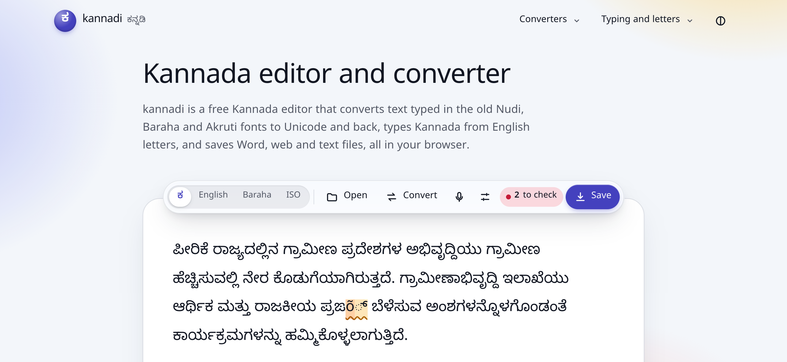
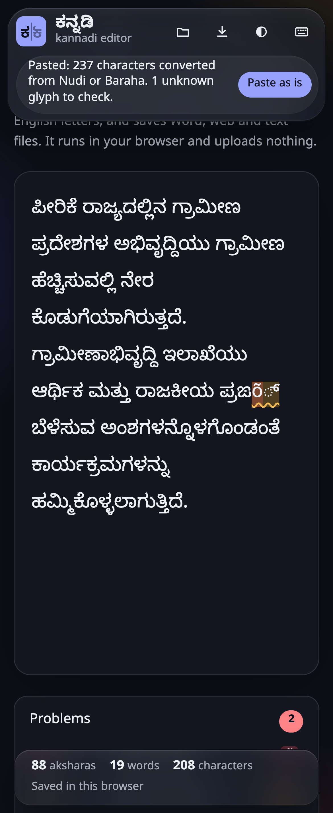

# kannadi

Convert Kannada documents typed in the legacy Nudi, Baraha, Nudi B-Akshara, Kan-Eng, Akruti and Shree-Lipi fonts to Unicode, and back. kannadi is a Rust library, a command-line tool that converts whole folders of TXT, HTML, DOCX and PDF files, and an editor that runs in the browser.

ಕನ್ನಡಿ (kannaḍi) means mirror.

<p>
  
  
</p>

## Why

For years, Kannada text in Karnataka was typed with Nudi and Baraha fonts that store glyph codes in place of letters. A file holds `PÀ£ÀßqÀ` and shows ಕನ್ನಡ only when the paragraph is set in the right font. Government orders, budget pages and newspaper archives from that time cannot be searched, indexed or read aloud until they are converted.

## Install

```sh
# Command-line tool (Rust 1.89 or later)
cargo install --locked --git https://github.com/openkannada/kannadi kannadi-cli
kannadi to-unicode old-orders/ --out converted/

# Library, in Cargo.toml (not on crates.io yet)
kannadi = { git = "https://github.com/openkannada/kannadi" }
```

The editor page is not hosted yet. To run it locally, see [Editor page](#editor-page).

## Measured results

| Check | Result | How it is measured |
|---|---|---|
| Nudi and Baraha to Unicode, benchmark corpus | 207 of 207 lines match the reviewed output; 1 line flagged | `cargo run -p kannadi --example corpus` on [corpus/](https://github.com/openkannada/kannadi/tree/main/corpus). No line is verified by a Kannada reader yet, so today this compares the converter with its own reviewed output. A 100-line reader check is in progress. |
| Unicode to Nudi, as typed | 9,029 of 9,047 words encode to the exact bytes that were typed | Words from Karnataka government pages of 2002. The rest differ in typing habits, such as a zero typed for ಂ. |
| Akruti to Unicode | 6 unknown glyphs and 22 malformed syllables in 908,075 glyphs, each read against the page: errors in the source, or syllables the PDF split across 2 lines | 16,857 lines from 35 documents: 33 Karnataka Acts and Ordinances and 2 budget papers. See [docs/akruti.md](https://github.com/openkannada/kannadi/blob/main/docs/akruti.md). |
| Nudi B-Akshara to Unicode | 0 unknown glyphs and 0 malformed syllables on the 5 Legislative Assembly member pages; 65 unknown glyphs and 113 malformed syllables in 639,208 glyphs of 22 budget and Assembly papers, many of which lost ಂ when the PDF was made | 190 fixture lines from 15 documents, read against the glyphs embedded in the PDFs. See [docs/nudi-b.md](https://github.com/openkannada/kannadi/blob/main/docs/nudi-b.md). |
| Kan-Eng to Unicode | 1 unknown glyph and 11 malformed syllables in 21,455 glyphs, each read against the glyphs embedded in the PDFs: errors in the source, and syllables split by a table cell | 833 distinct lines from 45 Karnataka budget papers of 2002 to 2014, and 118 fixture lines from 36 of them. See [docs/kan-eng.md](https://github.com/openkannada/kannadi/blob/main/docs/kan-eng.md). |
| Shree-Lipi to Unicode | 0 unknown glyphs and 20 malformed syllables in 233,346 glyphs, each read against the text rendered in the font: ಆ್ಯ for the English vowel, and errors in the source | 1,660 lines from 173 Udayavani newspaper pages of 2003 and 2004. See [docs/shree-lipi.md](https://github.com/openkannada/kannadi/blob/main/docs/shree-lipi.md#the-shree-lipi-table). |
| Transliteration round trip | Exact on every generated string | Property tests: 2,000 random strings per run, 50,000 in CI |
| ISO 15919 against vidyut-lipi | Same output on 5,000 random words per run, apart from 1 documented difference | `tests/differential.rs` |

Not measured yet: a comparison with the other open converters on the same verified lines. It needs the reader check first.

## Status

Version 0.1, in development.

| Part | State |
|---|---|
| Akshara segmentation | Done |
| Normalization and Old Kannada modernization | Done |
| Transliteration: ISO 15919, IAST, Baraha phonetic | Done |
| Kannada numerals | Done |
| Sound-alike keys for fuzzy search and loose Latin typing | Done |
| Typo suggestions for well-formed text: ರೃ and ರ್ಋ for ಋ | Done; listed in the command-line report |
| Nudi and Baraha to Unicode | Done in the library, the command-line tool and the editor page; waiting on a native reader's check of 100 sample lines |
| Unicode to Nudi and Baraha | Done in the library, the command-line tool and the editor page |
| Akruti to Unicode and back | To Unicode in the library, the command-line tool and the editor page; back to Akruti in the library. Checked on 908,075 glyphs from 35 documents; a Kannada reader's check of 125 lines is pending |
| Nudi B-Akshara to Unicode and back | To Unicode in the library, the command-line tool and the editor page; back to Nudi B-Akshara in the library. Checked on 643,777 glyphs from 27 documents; a Kannada reader's check of 190 lines is pending |
| Kan-Eng to Unicode and back | To Unicode in the library, the command-line tool and the editor page; back to Kan-Eng in the library. Checked on 21,455 glyphs from 45 budget papers; a Kannada reader's check of 118 lines is pending |
| Shree-Lipi (Shree-Kan-0850) to Unicode and back | To Unicode in the library, the command-line tool and the editor page; back to Shree-Lipi in the library. Checked on 233,346 glyphs from 173 newspaper pages; a Kannada reader's check of the 140 fixture lines is pending |
| Other layouts: AkliteKndPadmini and C-DAC's KN-Nandi | Waiting for documents: a table needs at least 100 lines of public text, and 19 lines and 15 distinct lines have been found. See [docs/other-layouts.md](https://github.com/openkannada/kannadi/blob/main/docs/other-layouts.md) |
| Newspaper fonts of 1999 to 2008 | LangscapeKndPadmini, LLPad and SKPadmini read in the Akruti layout with `--legacy-font`; KN-TTNandi, KNW-TTNandi, SHREE_DECCAN, Shree_DecMod and LangscapeKndPadma fit no table yet. See [docs/other-layouts.md](https://github.com/openkannada/kannadi/blob/main/docs/other-layouts.md#newspaper-fonts-on-archived-pages) |
| Test corpus | 207 lines from 31 government pages of 2002 in [corpus/](https://github.com/openkannada/kannadi/tree/main/corpus); a Kannada reader's check is pending |
| Editor page that runs in the browser, with no upload | Built, not hosted yet: [web/](https://github.com/openkannada/kannadi/tree/main/web) |
| Command-line tool for TXT, HTML, DOCX and PDF | Done; PDF to Unicode only |
| Shaping tests for Kannada fonts, with results for 41 fonts | Done: [tools/fontqa](https://github.com/openkannada/kannadi/tree/main/tools/fontqa) |

## Example

```rust
use kannadi::{aksharas, fix_zero_as_anusvara, modernize, normalize, numerals, transliterate, Scheme};

// Aksharas: the units a reader sees as 1 letter.
let parts: Vec<&str> = aksharas("ಸ್ತ್ರೀಯರು").map(|a| a.text).collect();
assert_eq!(parts, ["ಸ್ತ್ರೀ", "ಯ", "ರು"]);

// Normalization fixes text that looks right but compares wrong.
assert_eq!(normalize("ಕಿ\u{0CD5}ರ್ತಿ"), "ಕೀರ್ತಿ"); // vowel sign typed in 2 parts

// For converted or scanned text: a digit zero typed for an anusvara.
assert_eq!(fix_zero_as_anusvara("ಬೆ೦ಗಳೂರು"), "ಬೆಂಗಳೂರು");

// Old Kannada to modern spelling, for search.
assert_eq!(modernize("ಅಱಿವು ಬಾೞ್"), "ಅರಿವು ಬಾಳ್");

// Transliteration, both ways.
assert_eq!(transliterate("ಕನ್ನಡ ನಾಡು", Scheme::Kannada, Scheme::Iso15919), "kannaḍa nāḍu");
assert_eq!(transliterate("kannaDa nADu", Scheme::Baraha, Scheme::Kannada), "ಕನ್ನಡ ನಾಡು");

// Numerals.
assert_eq!(numerals::format(1956), "೧೯೫೬");
```

Run `cargo run --example demo` to see each feature on 1 sentence.

## Legacy fonts

Nudi (up to version 5) and Baraha's ANSI fonts store glyph codes in place of letters, so the text reads as `PÀ£ÀßqÀ` outside the font. `legacy::nudi_to_unicode` converts it:

```rust
use kannadi::legacy::{nudi_to_unicode, Options};

let converted = nudi_to_unicode("PÀ£ÀßqÀ", &Options::default());
assert_eq!(converted.text, "ಕನ್ನಡ");
assert!(converted.unknown.is_empty());
```

- **How the table was built.** The glyph table in [nudi.tsv](https://github.com/openkannada/kannadi/blob/main/crates/kannadi/data/nudi.tsv) comes from the Nudi font files. Each glyph was rendered and matched against the Unicode version of the same typeface, which HarfBuzz labels. The table was then checked against typed letter charts and Karnataka government pages from 2002.
- **Nothing is dropped silently.** Glyphs the converter cannot place are kept in the output and listed in `unknown`, with their byte offsets. Syllables that cannot be valid Kannada are listed in `malformed`: a mark with no letter, 2 vowel signs on 1 consonant, a sign on a vowel letter, or a consonant shape typed without its sign. Spacing glyphs carry no text and are the only glyphs dropped.
- **Unicode already in the text.** Kannada characters, the dandas, ZWNJ and ZWJ are never legacy glyph codes, so they pass through unchanged and unreported. `legacy::is_unicode(text)` is true for text that is already Unicode Kannada and holds no legacy glyphs, which needs no conversion at all.
- **Digits.** The `k` variants of the Nudi fonts draw Kannada digits at the ASCII digit positions. For text in those fonts, set `Options::kannada_digits`.
- **Typed zeros.** A zero typed between 2 Kannada letters in place of an anusvara (ಪ್ರಾರ0ಭ) becomes ಂ by default.
- **Limits.**
  - Some glyphs look alike: the ೂ in ವೊ and ಮೊ, the ು in ವು and the tail of ಮ, and the subscript ಜ and ಞ. A document that used the wrong key converts to what was typed.
  - English text set in the same font is converted too, so pass only the legacy-font runs.

Run `cargo run --example nudi -- file.txt` to convert a Windows-1252 text file.

Other layouts go through `legacy::to_unicode` and `legacy::from_unicode` with a `Layout`. `Layout::Akruti` covers AkrutiKndPadma and its weights, used in Karnataka Acts of 2001 to 2003, `Layout::ShreeLipi` covers Shree-Kan-0850, used by the Udayavani newspaper's web pages, `Layout::NudiB` covers Nudi B-Akshara, the bilingual Nudi font of Karnataka budget and Assembly papers, and `Layout::KanEng` covers the bilingual Kan-Eng fonts, such as Kan-EngPraja and Kan-EngDeepa, of Karnataka budget papers of 2002 to 2014:

```rust
use kannadi::legacy::{to_unicode, Layout, Options};

let converted = to_unicode("dâ}â", Layout::Akruti, &Options::default());
assert_eq!(converted.text, "ಕನ");
```

The Akruti table was derived from the fonts embedded in public PDFs and checked against the pages; [docs/akruti.md](https://github.com/openkannada/kannadi/blob/main/docs/akruti.md) has the method and results. The Shree-Lipi table was derived from the font Udayavani served with its pages and checked against them; [docs/shree-lipi.md](https://github.com/openkannada/kannadi/blob/main/docs/shree-lipi.md#the-shree-lipi-table) has the method and results. The Nudi B-Akshara table was derived from the fonts embedded in budget and Assembly PDFs; [docs/nudi-b.md](https://github.com/openkannada/kannadi/blob/main/docs/nudi-b.md) has the method and results. The Kan-Eng table was derived from the fonts embedded in budget PDFs; [docs/kan-eng.md](https://github.com/openkannada/kannadi/blob/main/docs/kan-eng.md) has the method and results. The command-line tool reads these layouts too. So does the editor page: by font name in DOCX and HTML files, and otherwise (pasted text, text files, HTML with no font, the Convert button) in the layout that converts best, chosen by `legacy::best_layout` once for all such text in a paste, a file or a selection.

`legacy::unicode_to_nudi` goes the other way, for documents that must still be printed in a legacy font:

```rust
use kannadi::legacy::unicode_to_nudi;

let encoded = unicode_to_nudi("ಕನ್ನಡ");
assert_eq!(encoded.text, "PÀ£ÀßqÀ");
assert!(encoded.is_clean());
```

- **Storage order.** Each akshara is written the way typists stored it: the consonant shape, the vowel sign, the subscripts, ೃ and the length marks ೕ and ೖ, the arkavattu, then ಂ or ಃ. Where the layout has 2 glyphs for 1 sign, such as the ು of ವು or a second subscript ರ, the table marks which one the font uses there. On 9,047 words from 35 Karnataka government pages from 2002, 9,029 encode to the exact bytes that were typed. The rest differ in typing habits: a zero for ಂ, an extra spacing glyph, or ರ್ typed as its own syllable.
- **Round trip.** For well-formed Kannada, converting to Nudi and back gives the same text. A property test checks this.
- **Unencodable characters.** Characters the layout has no glyph for, such as ಌ, ೄ, ೝ, the nukta, ZWJ, ZWNJ, Latin letters and spaces with no Windows-1252 byte, are kept in the output and listed in `unencodable` with their byte offsets. Aksharas that are not well formed, such as 2 vowel signs on 1 consonant, are listed in `malformed`. Kannada digits are written as ASCII digits; set the text in a `k` font to show Kannada digits.

## Editor page

[web/](https://github.com/openkannada/kannadi/tree/main/web) is a static Kannada editor that runs in the browser. The crate runs as WebAssembly through the bindings in [crates/kannadi-wasm](https://github.com/openkannada/kannadi/tree/main/crates/kannadi-wasm), so text never leaves the device.

- Paste text, or open a TXT, DOCX or HTML file. Nudi, Baraha, Nudi B-Akshara, Kan-Eng, Akruti and Shree-Lipi text is converted to Unicode. In DOCX files, only text set in one of their fonts is converted; in HTML files, also text with no font that looks like legacy codes.
- Unknown glyphs and malformed syllables are marked in the text and listed beside it. Selecting one offers checked fixes, or a replacement typed in Baraha letters.
- Type Kannada with Baraha or ISO 15919 letters.
- Normalize, modernize Old Kannada letters, and count aksharas and words.
- Save as DOCX, TXT or HTML, or as Nudi text for documents that must still be set in a legacy font. The last document is kept in the browser's local storage.

The build writes 6 pages from 1 template: the editor home, Nudi to Unicode, Unicode to Nudi, Baraha to Unicode, Kannada typing, and English to Kannada typing. Each page has its own title, definition, how-to, FAQ and JSON-LD; the content is in [web/site/pages.mjs](https://github.com/openkannada/kannadi/blob/main/web/site/pages.mjs). The typing pages' letter charts are computed by the crate's transliterator at build time. Set `KANNADI_SITE_URL` to the site's address to add canonical links, `og:url` and a sitemap; without it they are left out. `node web/site/og.mjs` renders the Open Graph cards with Chrome.

Build and run it locally. It needs the `wasm32-unknown-unknown` target and the `wasm-bindgen` command at the version in `Cargo.lock`:

```sh
rustup target add wasm32-unknown-unknown
cargo install wasm-bindgen-cli --version 0.2.130 --locked
web/build.sh
python3 web/serve.py 8000
```

`web/dist` is a plain folder of static files that any static host can serve. `web/serve.py` is only for local testing: the standard `python3 -m http.server` drops some of the page's parallel requests. `node --test web/test/units.mjs` tests the page modules, and `node web/test/smoke.mjs` checks the built package.

## Command-line tool

The `kannadi` binary in `crates/kannadi-cli` converts files and folders in both directions:

```sh
cargo install --path crates/kannadi-cli
kannadi to-unicode old-orders/ --out converted/
kannadi to-nudi letter.txt --out for-printing/ --strict
```

- A file goes to `OUT/<file name>`. A folder goes to `OUT/<folder name>/`, with its subfolders kept. Hidden files, files already under `OUT`, and symbolic links to folders are skipped. The tool stops before writing anything if an output would overwrite any input or 2 inputs would share an output; paths are compared with links and `..` resolved, ignoring case.
- Text files with a UTF-16 or UTF-8 byte order mark, or valid UTF-8, are read as such. Other legacy text files are read as Windows-1252. `to-unicode` copies a text file that is already Unicode Kannada as it is, so its English words stay English and `--strict` passes. Unicode output is UTF-8. Nudi output is Windows-1252, with `?` for each character that has no glyph; those characters are in the report.
- When a file has unknown glyphs, malformed syllables, unencodable characters or likely typos, the tool writes `FILE.report.tsv` next to the output: the line, the problem, and up to 30 characters of Unicode text on each side. Rows are in line order. A run with none removes an old report. Likely typos come from `typos::find` on the text `to-unicode` writes, such as `ಋ for ರೃ (ra-vocalic-r)`. They are suggestions and do not count as problems. Nudi's ಋ with an arkavattu gets 2 rows: a malformed syllable, since an arkavattu cannot sit on a vowel letter, and the likely typo `ಋ for ರ್ಋ`.
- Exit status: 0 on success, even when reports list problems or likely typos; 1 with `--strict` when a file has a problem; 2 for bad arguments, or a file that could not be read, converted or written (a PDF given to `to-nudi` is one). 2 wins over 1. After a file fails, the other files are still converted. If an output would overwrite an input, nothing is written.
- `kannadi --help` and `kannadi to-unicode --help` give every option, with examples. `kannadi completions bash` (or `zsh`, `fish`, `powershell`, `elvish`) prints a completion script, and `kannadi manpages DIR` writes the man pages. Copies of both are in [crates/kannadi-cli/assets](https://github.com/openkannada/kannadi/tree/main/crates/kannadi-cli/assets). Packagers install them as `share/man/man1/*.1`, `share/bash-completion/completions/kannadi`, `share/zsh/site-functions/_kannadi` and `share/fish/vendor_completions.d/kannadi.fish`.
- `to-unicode` takes `--kannada-digits` and `--keep-zeros`, the same settings as `legacy::Options`.
- **HTML.** Only text set in a legacy font is converted to Unicode, in that font's layout. The font of each piece of text comes from its `style` attribute, then `<style>` rules for tags and classes such as `td.xl24` or `.font12` (the most specific, then the last), then `<font face>`, inherited from enclosing elements. End tags HTML lets authors leave out, such as `</td>` and `</p>`, are closed where a browser would close them. Legacy font names are replaced with `--font` (Noto Sans Kannada by default). `to-nudi` converts Kannada text outside legacy fonts and wraps it in a span set in `--font` (Nudi 01 e by default); the rest of the text is copied as it was. A page that declares a Windows-1252 or ISO-8859-1 charset is read that way. Output is UTF-8, and the charset declaration says so. Text in `<title>`, `<textarea>` and attribute values is not converted, and a syllable split across tags is converted piece by piece, so it shows as malformed in the report. More complex selectors and the `font` shorthand are not read.
- **DOCX.** A run's font comes from its own `w:rFonts`, its character style, its paragraph style (or the default paragraph style), or the document defaults, following `basedOn`. Only runs whose Latin font is a legacy font are converted to Unicode, in that font's layout. Their fonts are set to `--font`. Word often splits a word across runs; text is moved between neighboring runs so no syllable is split. `to-nudi` moves each Kannada run of text into a new run set in `--font`, with the rest of the run's formatting. The body, headers, footers, footnotes, endnotes and comments are converted; every other part of the package is copied unchanged. Report rows name the part and paragraph; the fallback copy of a text box is converted but not reported twice. Where a run sets `w:b`, `w:i` or `w:sz` but not their complex-script copies, these are added, since Word formats Kannada with `w:bCs`, `w:iCs` and `w:szCs`; `to-nudi` copies them the other way. Tracked deletions are converted too. Not done: bold, italic and sizes that come from styles, symbols inserted with `w:sym`, fonts of paragraph marks and styles, and parts written with a namespace prefix other than `w:`.
- **PDF.** `to-unicode` reads PDF files and writes their text to `NAME.pdf.txt`, with text in legacy fonts converted, Nudi B-Akshara, Kan-Eng, Akruti and Shree-Lipi included. Legacy fonts are found by name, or by their text when the PDF hides the name. A font whose codes were renumbered is read through its ToUnicode map when the map gives the codes back. Other renumbered fonts, and legacy fonts in layouts without a table, such as Shree-Kan-0851, are reported and left out. [docs/pdf.md](https://github.com/openkannada/kannadi/blob/main/docs/pdf.md) has the method and results on public PDFs.
- **Legacy font names.** The tool knows the ANSI Nudi fonts (Nudi 01 e to Nudi 05 k, Nudi Akshara) and Baraha's BRH fonts for Kannada, in the Nudi layout, Nudi B-Akshara (NudiB-Akshar) and the Kan-Eng fonts (Kan-EngPraja, Kan-EngDeepa and the others named Kan-Eng), each in its own layout, AkrutiKndPadma and its weights, in the Akruti layout, and Shree-Kan-0850, in the Shree-Lipi layout. Other Shree-Kan fonts are known as legacy fonts with no table. `--legacy-font "NAME=akruti"` adds another in the layout named after `=`; with no `=`, it is in the `--layout` layout. `to-unicode --layout nudi-b`, `--layout kan-eng`, `--layout akruti` or `--layout shree-lipi` reads text files in that layout; the default is Nudi. `to-nudi` writes Nudi only.

## Segmentation

`aksharas(text)` splits text into aksharas and other segments. Joining the segments gives back the input exactly. The rules cover conjuncts of any length, nukta, ZWJ and ZWNJ after a virama, dead consonants at the end of a word, and Old Kannada letters. They are written out in [akshara.rs](https://github.com/openkannada/kannadi/blob/main/crates/kannadi/src/akshara.rs).

The legacy converter uses segmentation to check its own output.

## Normalization

`normalize(text)` applies Unicode NFC, then 2 Kannada fixes:

1. ಉ + ಾ becomes ಊ, and ಋ + ಾ becomes ೠ. They look the same, and Unicode says to use the single letter.
2. A mark typed twice in a row (್್, ಂಂ) is kept once.

`fix_zero_as_anusvara(text)` turns a Kannada zero (೦) written right after a letter into an anusvara (ಂ). Legacy fonts and OCR often mix the 2 up. It is a separate step because it also changes a number written straight after a word, such as ಕೊಠಡಿ೦೧.

`modernize(text)` maps ೞ to ಳ, ಱ to ರ and ೝ to ನ್. When a consonant follows ೝ, a ZWNJ keeps the ನ್ from joining it.

`typos::find(text)` suggests fixes for spellings that are valid Unicode but are often typing mistakes in modern Kannada. Sanskrit spells r + ṛ both ways below, so each finding is a suggestion for the writer, and nothing is changed in bulk. The rules:

- `ra-vocalic-r`: ರೃ (ra with the vowel sign ೃ) at the start of a syllable suggests ಋ, as in ನೈರೃತ್ಯ for ನೈಋತ್ಯ. Baraha phonetic typing produces it from `r~ru`.
- `ra-virama-vocalic-r`: ರ್ followed by ಋ suggests ಋ, as in ನೈರ್ಋತ್ಯ for ನೈಋತ್ಯ. Nudi typists draw ಋ with an arkavattu after it, which converts to ರ್ಋ. ರ್ before any other vowel letter, as in ಆರ್ಎನ್ಎ and ಕುರ್ಆನ್, is left alone, and so is ರ್ joined to ಋ by ZWNJ or ZWJ.

In Kannada Wikipedia (6.2 million lines), `ra-virama-vocalic-r` finds 1 spelling: ನಿರ್ಋತಿ, which Wikipedia writes ನಿಋತಿ 4 times elsewhere. It passes over 623 uses of ರ್ directly before another vowel letter, and 3,141 with ZWNJ or ZWJ between. In the Alar dictionary it finds 13, all Sanskrit-style headwords such as ನೈರ್ಋತಿ, which a dictionary keeps on purpose. The converter's 792 test lines have none.

## Transliteration

| Kannada | ISO 15919 | IAST | Baraha |
|---|---|---|---|
| ಕನ್ನಡ | kannaḍa | kannaḍa | kannaDa |
| ಬೆಂಗಳೂರು | beṁgaḷūru | beṃgaḷūru | beMgaLUru |
| ಸಂಸ್ಕೃತ | saṁskr̥ta | saṃskṛta | saMsk~ruta |
| ಏಳು | ēḷu | ēḷu | ELu |
| ಅಱಿವು | aṟivu | aṟivu | arxivu |
| ಮೞೆ | maḻe | maḻe | maLxe |

The full list of tested words is in [transliteration.tsv](https://github.com/openkannada/kannadi/blob/main/crates/kannadi/tests/fixtures/transliteration.tsv).

- **Exact round trips.** Kannada to Latin and back gives the same code points for Kannada text, including spaces, punctuation and joiners. The 1 exception is digits, below. Property tests check 2,000 random strings per run, and 50,000 in CI.
- **Separators.** When 2 letters would otherwise read as 1, a separator goes between them: `k:ha` for ಕ್ಹ and `ka:i` for ಕಇ in ISO 15919 and IAST. Baraha uses `~h` for ಹ after a consonant (`bakkiMg~hAm`), as Baraha's own documentation does, and `_` elsewhere.
- **Short and long e and o.** ಎ/ಏ and ಒ/ಓ stay apart in all 3 schemes.
- **IAST for Kannada.** Plain IAST was made for Sanskrit and has no letters for short e, short o, ಱ, ಳ or ೞ. This crate uses the ISO 15919 letters for those, and writes vocalic l as `l̥` because `ḷ` is ಳ.
- **Input.** Baraha accepts its alternative spellings (`aa` or `A`). ISO 15919 and IAST input is read without regard to case or Unicode composition.
- **Digits.** Kannada digits become ASCII digits in Latin output. Use `numerals::to_kannada_digits` to go the other way.
- **Pass-through.** Characters a scheme has no spelling for are copied as they are and still round-trip. Examples: ZWNJ in ISO 15919, nakaara pollu (ೝ), and nukta forms other than ಜ಼ and ಫ಼ in ISO 15919 and IAST.
- **Escapes.** A literal character that a scheme would read as part of a token is written with a backslash: `\'` for an apostrophe in ISO 15919 and IAST, `\~` `\@` `\^` in Baraha, and `\\` for a backslash. A `:` or `_` is a separator only between 2 letters, so `samaya: 10:30` stays as written.
- **Limits.** Latin to Kannada converts every Latin letter it can read, including English words.
- **IAST from Sanskrit sources.** In Sanskrit IAST, `e` and `o` are long vowels. This crate reads them as short ಎ and ಒ, so Sanskrit text in IAST comes out with short vowels.
- **Baraha `R`.** Current Baraha documentation uses `R` and `rx` for ಱ, and `~ru` for ಋ. Older Baraha text that writes ಋ as `Ru` (as in `kRuShNa`) reads as ಱು.

ISO 15919 output is cross-checked against [vidyut-lipi](https://github.com/ambuda-org/vidyut) on 5,000 random words per test run. The 2 crates differ on dead ಱ only: vidyut-lipi writes `r̆`, after the Marathi eyelash ra, and this crate writes `ṟ`. Nukta forms other than ಜ಼ and ಫ಼ are left out of the comparison.

## Old Kannada

ಱ, ೞ (which Unicode names "KANNADA LETTER FA"), the vowels ೠ, ಌ and ೡ with their signs, candrabindu, jihvamuliya and upadhmaniya are handled in segmentation and transliteration. Nakaara pollu (ೝ) is segmented as a syllable and passes through transliteration unchanged. The archaic vowel signs proposed to Unicode in 2014 are not encoded yet, so no software can support them.

## Prior art

See [docs/prior-art.md](https://github.com/openkannada/kannadi/blob/main/docs/prior-art.md).

## Architecture

The crate is split into small modules, each with 1 job:

| Module | Job |
|---|---|
| `chars` | Classifies characters in the Kannada block |
| `akshara` | Splits text into aksharas |
| `normalize` | Unicode NFC plus Kannada fixes; Old Kannada modernization |
| `numerals` | Kannada digits: conversion, formatting, parsing |
| `phonetic` | Sound-alike keys for Kannada words and loose Latin spellings |
| `typos` | Well-formed spellings that are often typing mistakes, with suggested fixes |
| `translit` | 1 engine that romanizes and parses, driven by a table per scheme |
| `legacy` | Converts Nudi and Baraha glyph sequences to Unicode syllables and back, driven by the glyph table in `data/nudi.tsv` |

Scheme spellings and legacy glyph layouts are data tables read by 1 engine each. [AGENTS.md](https://github.com/openkannada/kannadi/blob/main/AGENTS.md) has the full guide for contributors.

## Development

```sh
cargo test
PROPTEST_CASES=50000 cargo test --release --test props
cargo clippy --all-targets
web/build.sh && node web/test/smoke.mjs && node --test web/test/units.mjs
```

The minimum supported Rust version is 1.75 for the `kannadi` library and 1.89 for the command-line tool.

## License

kannadi is free and open source. The code and the glyph tables are under the MIT license or the Apache License 2.0, at your choice: see [LICENSE-MIT](https://github.com/openkannada/kannadi/blob/main/LICENSE-MIT) and [LICENSE-APACHE](https://github.com/openkannada/kannadi/blob/main/LICENSE-APACHE). The docs are under [CC BY 4.0](https://github.com/openkannada/kannadi/blob/main/LICENSES/CC-BY-4.0.txt), and code examples in them may also be used under MIT or Apache 2.0. [REUSE.toml](https://github.com/openkannada/kannadi/blob/main/REUSE.toml) gives the license of every file, and [NOTICE.md](https://github.com/openkannada/kannadi/blob/main/NOTICE.md) lists the third-party material with its credit.

Not covered by these licenses:
- the excerpts of Karnataka government documents in `corpus/` and in the test fixtures, which are kept as short excerpts for testing, with their sources (see the [corpus data card](https://github.com/openkannada/kannadi/blob/main/corpus/README.md) and the [fixtures README](https://github.com/openkannada/kannadi/blob/main/crates/kannadi/tests/fixtures/README.md));
- the font names and copyright strings recorded in `tools/fontqa/results/`, which belong to their owners;
- the Noto fonts in `web/src/fonts/`, which are under the SIL Open Font License (`web/src/fonts/OFL.txt`).

The Shree-Lipi test lines were written for kannadi; no newspaper text is included. The names Open Kannada and kannadi, and the logo, are covered by [TRADEMARKS.md](https://github.com/openkannada/kannadi/blob/main/TRADEMARKS.md).

If kannadi helps your project, a mention or a link to [prasad.tech](https://prasad.tech) is appreciated.

Part of [Open Kannada](https://github.com/openkannada), free and open-source tools that make Kannada work properly on computers.
